# 널리잇다 · 선생님의 하루를 잇다

**시연 주소:** https://neolli-itda.vercel.app (로그인 없이 열림, 첫 화면에서 ‘시연으로 둘러보기’)

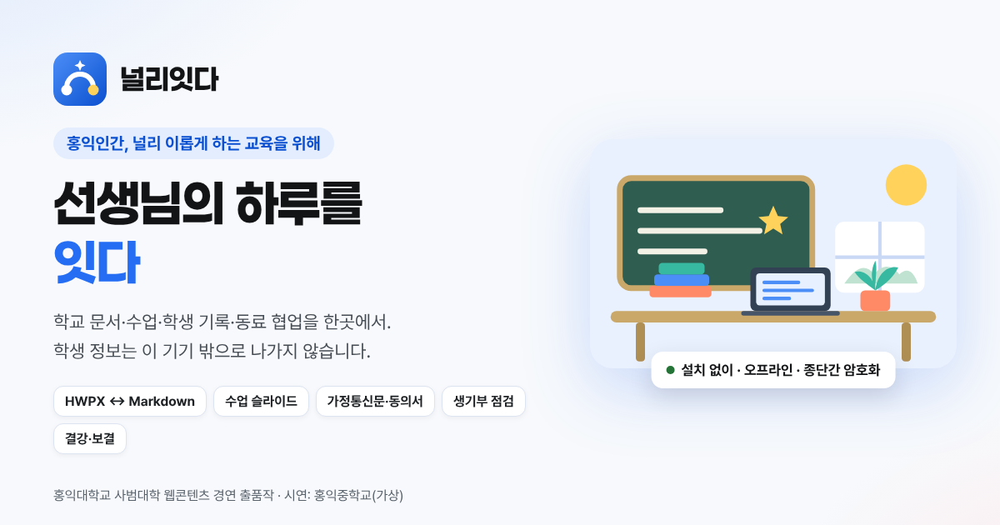

> 홍익대학교 사범대학 웹콘텐츠 경연 출품작(4차 개선판). 이전 작업명은 ‘교실잇다’였습니다.

**널리**는 「교육기본법」 제2조의 교육이념 **홍익인간(널리 인간을 이롭게 함)**에서, **잇다**는 흩어진 것을 이어 붙인다는 뜻에서 왔습니다. 한글 문서와 AI, 지도안과 수업, 교실과 가정, 담임과 동료 교사를 이어, 선생님이 서류에 쓰던 시간을 학생에게 돌려 드리는 교사용 작업 공간입니다. 시연은 가상 학교 **홍익중학교** 2학년 1반 담임 곽민혁 선생님의 하루를 따라갑니다. 사람·학생·시간표는 모두 지어낸 것이며 실제 학교와 관계없습니다.

## 문제 정의

중등 교사는 수업 밖의 **문서·연락·기록**에 하루의 많은 시간을 씁니다. 이를 도울 도구는 많지만 **학교 문서 형식(한글)**과 **학생 개인정보 규정**을 함께 지키지 못해, 결국 손으로 옮겨 적고 메신저로 조율합니다. 교육부도 2024년 「학교 행정업무 경감 및 효율화 방안」과 2026년 ‘학교 현장 가짜 일 줄이기’ 과제로 같은 문제를 짚었습니다.

| 벽 | 현장 | 널리잇다 |
|---|---|---|
| **문서의 벽** | HWP·엑셀·PDF로 흩어진 자료를 손으로 옮겨 적고, AI는 한글 파일을 제대로 읽지 못합니다. | 모든 파일 ↔ Markdown ↔ HWPX·DOCX·XLSX. 지도안은 슬라이드로, 내용은 통신문으로 이어집니다. |
| **개인정보의 벽** | 학생 정보를 외부 AI에 넣기 어렵고, 2026 기재요령은 AI 문장을 그대로 입력하는 것을 금지합니다. | 학생 기록은 담임 기기에서만 열리도록 암호화하고, AI에는 가린 내용만 넘기며, 점검은 교사가 합니다. |
| **협업의 벽** | 결강·보결과 교생 지도가 메신저와 종이로 흩어져 결정 과정이 남지 않습니다. | 교체 우선 보결 추천, 결재란, 관찰 초점 기반 교생 피드백이 암호 기록으로 남습니다. |

**해결 원칙:** ① 한 번 쓰고 여러 번 쓴다 ② 학생 정보는 기기 안에 ③ 학교 서식 그대로 ④ 판단은 교사가

| 과목별 수업 만들기 | 도우미 이음이 | |
|---|---|---|
| 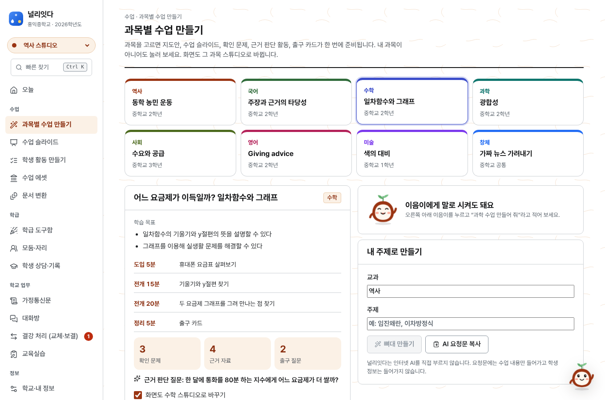 | 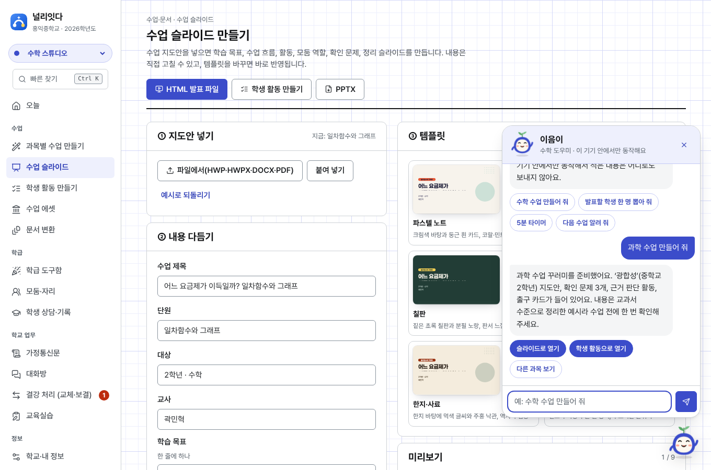 | |

| 과목별 스튜디오(역사·수학·과학·국어) | 학급 도구함: 룰렛 | 수업 에셋 |
|---|---|---|
| 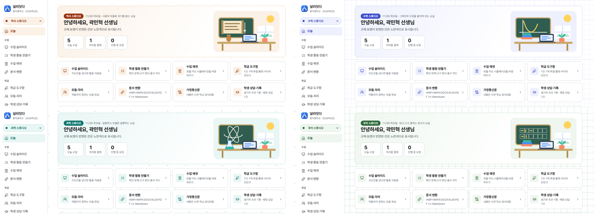 | 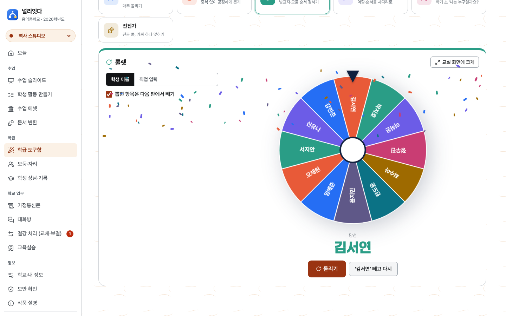 | 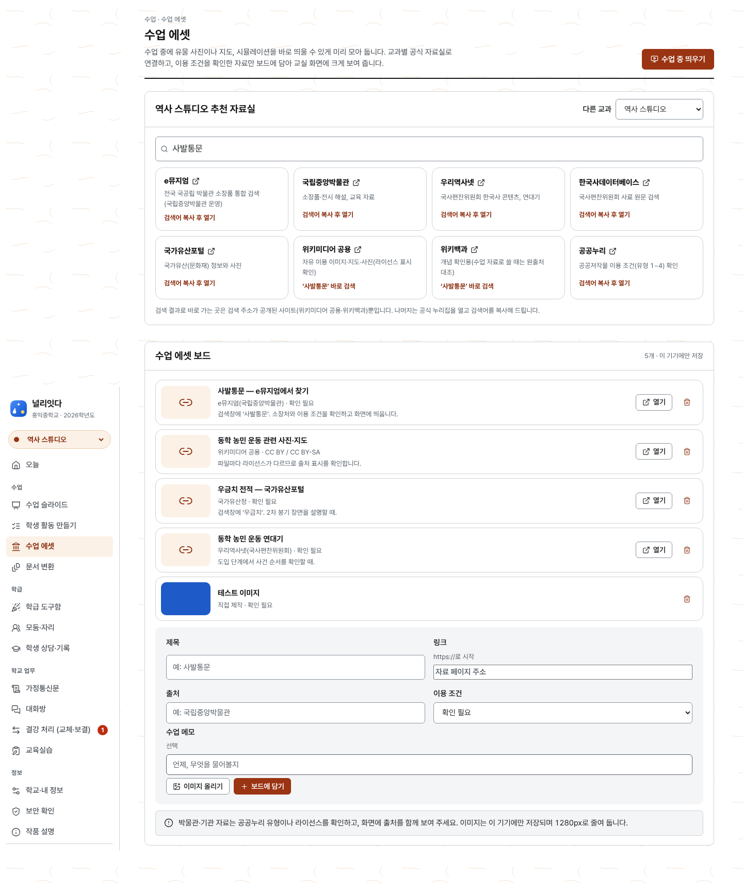 |

| 온보딩 ① 소개 | ② 세 가지 벽 | ④ 시작 방법 선택 |
|---|---|---|
| 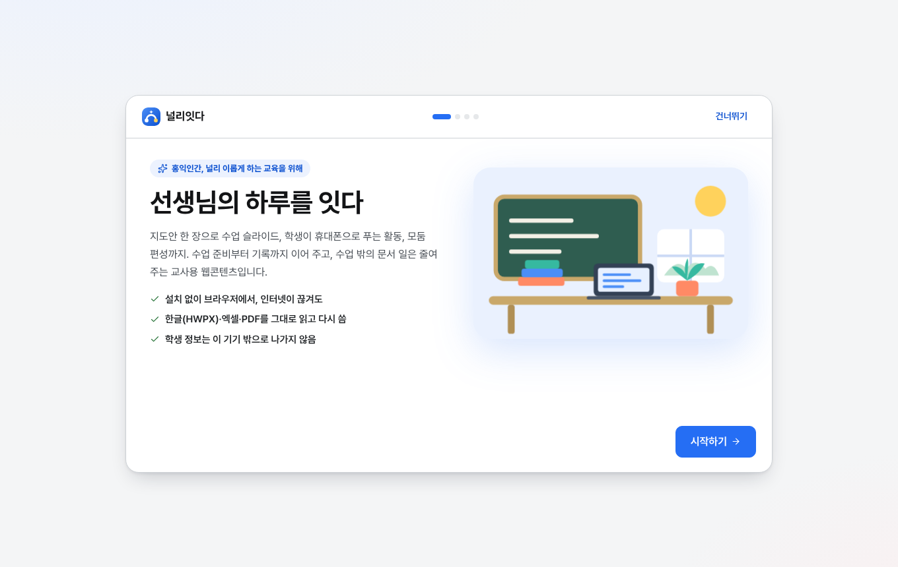 | 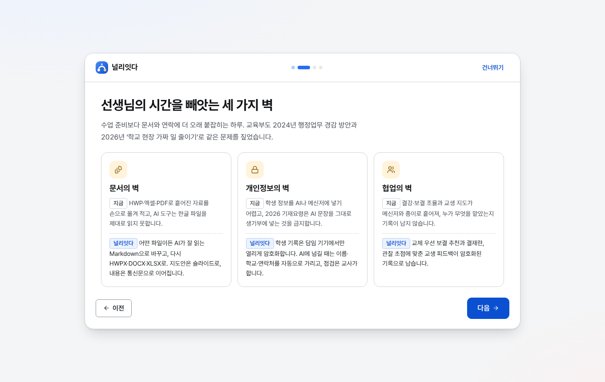 | 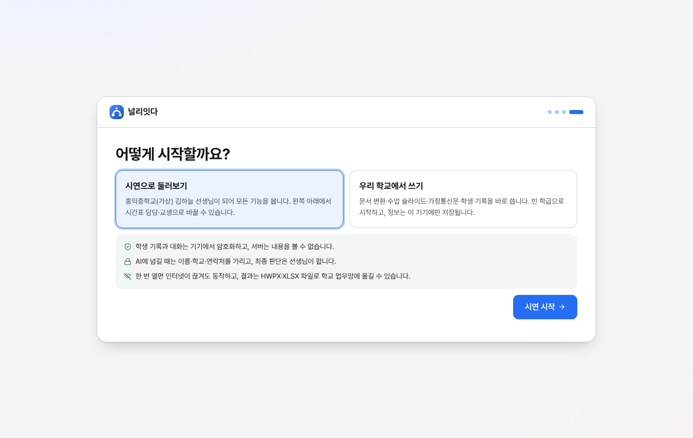 |

처음 열면 **온보딩**(소개 → 세 가지 벽 → 곽민혁 선생님의 하루 → ‘시연 둘러보기 / 우리 학교에서 쓰기’ 선택)이 나옵니다. 주소에 `?as=t1`처럼 사람을 지정하면 바로 들어갑니다.

## 기능

최종 방향과 기능 확정, 대회 조건 분석은 [`docs/DIRECTION.md`](docs/DIRECTION.md)에 있습니다.

| 현장 업무 | 널리잇다가 하는 일 |
|---|---|
| **과목별 스튜디오** | 역사·국어·수학·과학·사회·영어·예술체육 스튜디오. 교과를 고르면 강조색, 배경 무늬(한지·원고지·모눈·분자·등고선·공책 줄·물감), 오늘 화면 칠판 그림, 기본 슬라이드 템플릿(역사는 ‘한지·사료’), 추천 자료실이 함께 바뀝니다. 모든 스튜디오 색은 WCAG AA 대비를 테스트로 확인하고, 고대비 모드가 항상 우선합니다. |
| **수업 에셋** | 교과별 공식 자료실(역사: e뮤지엄·국립중앙박물관·우리역사넷·한국사DB·국가유산포털 등)로 바로 연결하고, 검색 주소가 공개된 곳(위키미디어 공용·위키백과)은 검색 결과로 바로 갑니다. 링크·이미지를 출처와 이용 조건(공공누리 유형)까지 담아 ‘수업 에셋 보드’에 모으고, 수업 중 교실 화면에 크게 띄웁니다(← → 넘기기). |
| **과목별 수업 만들기** | 역사(동학 농민 운동)·국어(주장과 근거)·수학(일차함수)·과학(광합성)·사회(수요와 공급)·영어(Giving advice)·미술(색의 대비)·창체(가짜 뉴스 가려내기) 8개 꾸러미. 과목을 고르면 지도안이 수업 슬라이드로, 확인 문제·근거 판단·출구 카드가 학생 활동으로 한 번에 열리고, 화면도 그 과목 스튜디오로 바뀝니다. 준비되지 않은 주제는 같은 모양의 뼈대와 AI 요청문(수업 내용만)을 만듭니다. 자료는 ‘교사 작성 예시’·‘교사 요약’으로 표시합니다. |
| **도우미 이음이** | 씨앗에 새싹이 난 캐릭터 챗봇. 인터넷 AI 없이 브라우저 안에서 규칙으로 동작하고, 대화는 저장하거나 보내지 않습니다. “수학 수업 만들어 줘”(꾸러미), “발표할 학생 뽑아 줘”(암호 난수), “5분 타이머”, “다음 수업”, “바이트: …”(NEIS 바이트), 날짜·금액 표기, 화면 찾기. 모르는 말에는 할 수 있는 일을 보여 줍니다. 몸 색은 과목 스튜디오를 따릅니다. |
| **학급 도구함** | 1인 1역(매주 돌리기), 경품 추첨기(중복 제외·기록), 룰렛, 사다리타기(가로줄 가리기·길 그리기), 학기 초 인물 퀴즈, 진진가. 교실 화면 크게 보기와 스페이스바 진행, 당첨 순간 색종이 효과. 모든 뽑기는 브라우저 암호 난수(crypto.getRandomValues, 편향 없는 정수 추출)를 씁니다. |
| **학생 활동 만들기** | 확인 문제(즉시 피드백·해설), 근거 판단(자료마다 근거 분류 → 결론 → 학생이 분류한 자료로 반론 카드 자동 생성, 1차 작품 「이 사건의 이름은?」의 구조를 교과 공통으로 넓힘), 출구 카드(학습 목표별 자기 점검)를 글 몇 줄로 만들어 학생이 휴대폰으로 푸는 웹 파일(로그인·서버 없음, 오프라인)과 활동지 HWPX·DOCX로 내보냅니다. 수업 슬라이드에서 지도안을 넘겨받고, AI 문항 초안 요청문(학생 정보 없음)도 만듭니다. |
| **모둠 편성·자리 배치** | 명렬표로 모둠을 나누고 이끔이·기록이·발표이·지킴이를 배정합니다. 떨어뜨릴 짝, 앞자리, 편성 번호(같은 결과 재현), 교실 화면 크게 보기, HWPX·XLSX 저장. |
| **결강 처리** | 같은 학급 안에서 맞바꿀 수 있는 수업(교체)을 먼저 찾습니다. 없으면 공강 교사를 형평성·당일 부담·연속 수업·교과·학급 기준으로 비교한 보결 후보표를 보여 줍니다. 수업 인수인계서가 함께 가고, 상대 교사 동의 → 시간표 담당 결재가 **결재란**에 도장으로 남습니다. |
| **교육실습** | 임상장학 순서(계획 협의 → 수업 관찰 → 피드백 협의)로 진행합니다. 교생이 정한 관찰 초점을 지도교사 화면이 강조하고, 자기평가와 지도교사 평가를 모두 받은 뒤 차이가 큰 영역을 협의 주제로 제안합니다. 마지막에 **참관록** 서식으로 정리합니다. |
| **대화방** | 종단간 암호화 메시지와, 방 안의 모두가 함께 편집하는 체크리스트·투표. |
| **문서 변환** | HWP·HWPX·DOCX·XLSX·PPTX·PDF·CSV를 AI가 읽기 좋은 Markdown으로 바꾸고, 고친 내용을 HWPX·DOCX·XLSX·MD로 다시 저장합니다. 개인정보 가리기, AI용 복사, 다른 도구로 넘기기를 지원합니다. 파일은 브라우저 밖으로 나가지 않습니다. |
| **수업 슬라이드** | 지도안(파일 또는 붙여 넣기)에서 학습 목표·수업 흐름·발문·활동·모둠 역할·확인 문제·정리 슬라이드를 만듭니다. 템플릿 5종(파스텔 노트, 형광펜, 칠판, 블루 미니멀, 라벤더), 제목 글꼴은 페이퍼로지. **HTML 발표 파일**(글꼴 포함, 활동 타이머·발표자 메모)과 편집용 PPTX로 저장합니다. |
| **가정통신문** | 내용만 넣으면 발행 정보·안내 표·학교장 직인 자리·회신서까지 갖춘 A4 통신문이 됩니다. 쉬운 말 점검과 공공언어 검수를 함께 합니다. 학교에서 쓰는 HWPX 양식을 올리면 그 양식의 빈칸을 찾아 서식을 유지한 채 채워 줍니다. |
| **학생 상담·기록** | 누가기록, 상담 기록(대상·방식·영역·후속 조치), 생기부 기재 도우미. 세특·행특 등 항목별 NEIS 바이트 계산, 금지·주의 표현 점검, 관련 누가기록 끌어오기, 이름을 뺀 AI 초안 요청문, 학급 기재 현황과 NEIS 입력용 엑셀. 학급 기록은 담임 기기에서만 열립니다. |

| 오늘: 요약과 도구 바로가기 | 학교·내 정보 |
|---|---|
| 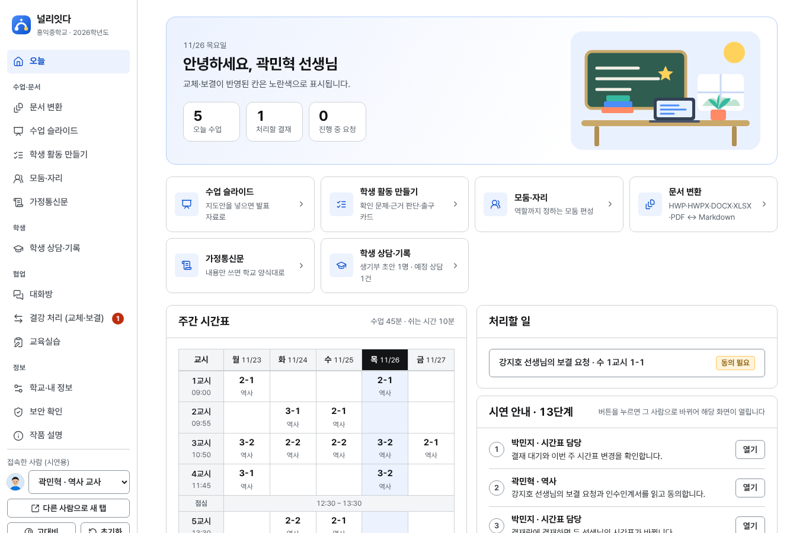 | 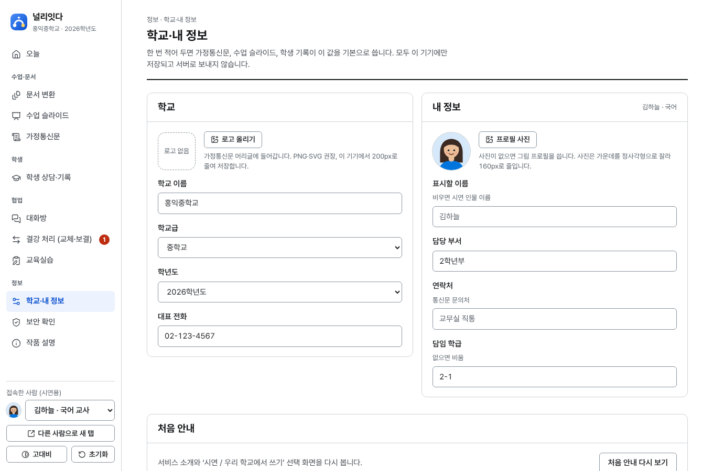 |

| 결강 처리: 교체 우선 제안과 보결 후보 비교표 | 결재란 |
|---|---|
|  |  |
| **교육실습: 관찰 초점과 관찰 기록** | **자기평가와 지도교사 평가 비교** |
|  |  |
| **문서 변환** | **수업 슬라이드** |
| 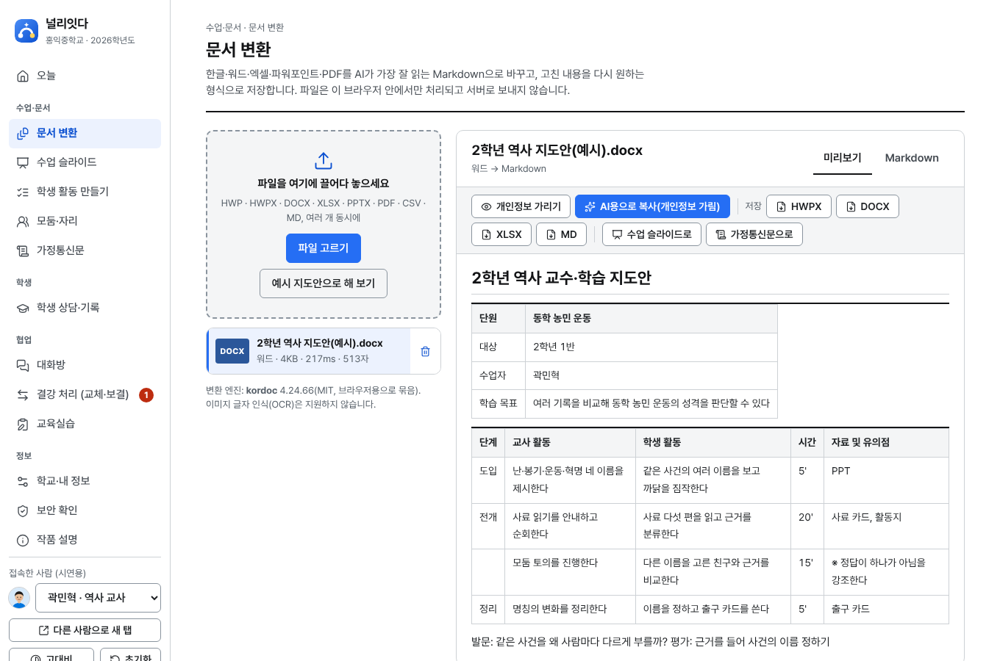 | 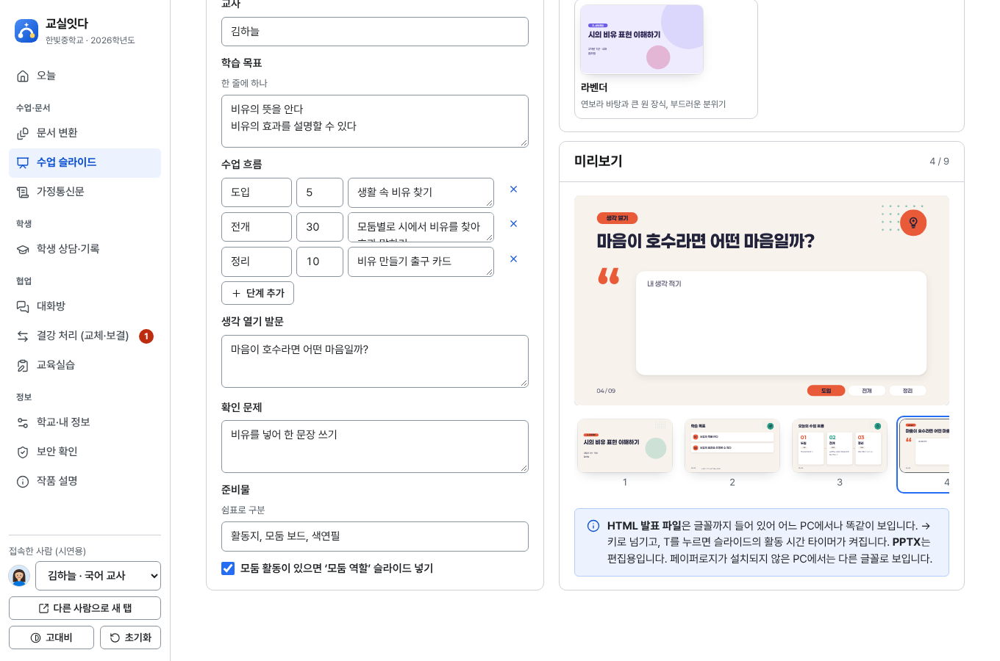 |
| **가정통신문: 개인정보 수집·이용 동의서** | **학생 상담·기록** |
| 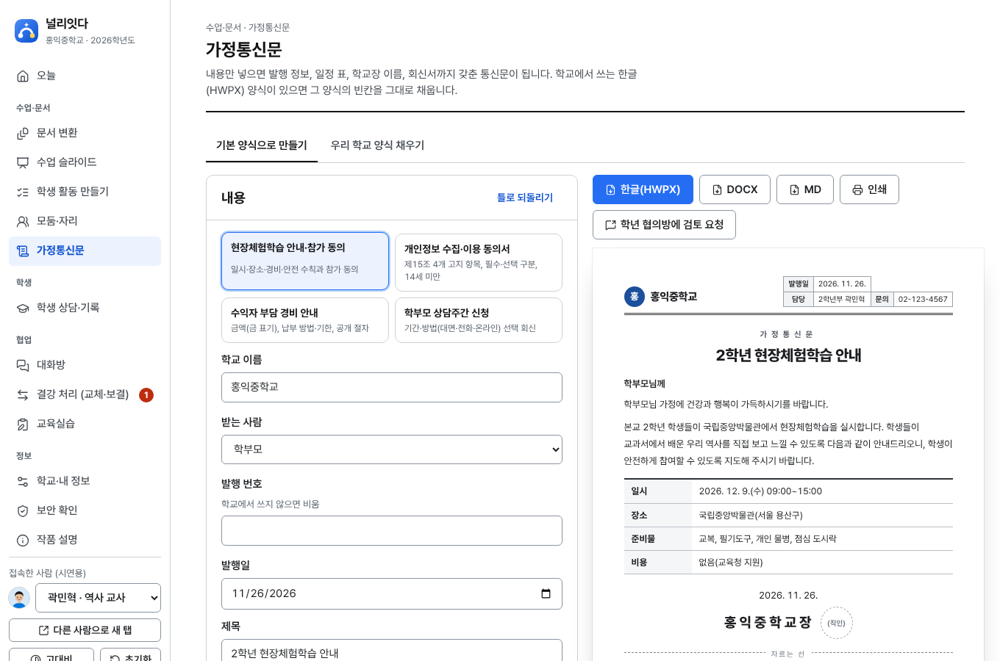 |  |
| **고대비 모드 (KRDS)** | **모바일** |
|  |  |

## 용어

| 용어 | 뜻 |
|---|---|
| 결강 | 출장·연가 등으로 교사가 자기 수업을 하지 못하는 것 |
| 교체 | 결강 수업과 다른 교사의 수업을 서로 맞바꾸는 것. 학생은 수업을 잃지 않고, 누구도 시수가 늘지 않습니다. |
| 보결 | 다른 교사가 결강 수업을 대신 맡는 것(보결수업) |

이전 판의 ‘대강’은 공문과 수당 명칭에 맞춰 ‘보결’로 바꿨습니다. ‘보강’은 빠진 수업을 나중에 채우는 보충 수업과 뜻이 겹쳐 쓰지 않습니다.

## 학교에서 바로 쓰기

문서 변환, 수업 슬라이드, 가정통신문, 학생 상담·기록은 서버 없이 이 기기 안에서 동작하므로 지금 바로 쓸 수 있습니다. 대화방, 결강 처리, 교육실습은 학교 중계 서버가 필요해 시연판으로만 동작합니다.

1. **학교·내 정보:** 학교 이름, 학교급(중·고), 학년도, 대표 전화, 학교 로고, 프로필 사진, 부서, 담임 학급을 적습니다. 통신문, 생기부 한도, 학생 기록이 이 값을 씁니다.
2. **기록이 지워지지 않게 하기:** 같은 화면에서 누릅니다. 홈 화면에 추가(앱 설치)하면 브라우저가 더 잘 허락합니다.
3. **학생 상담·기록 → 백업·새 학급 → 빈 학급으로 시작:** 시연 기록을 치웁니다. 그다음 NEIS에서 받은 명렬표(엑셀)를 불러옵니다.
4. **암호 백업:** 학기마다 `.kyosil` 암호 백업 파일을 받아 학교 보안 USB 등에 둡니다. 암호를 잃으면 아무도 열 수 없습니다.
5. **망 분리:** 인터넷망 PC에서 쓰고, 만든 HWPX·XLSX를 학교 절차에 따라 업무망으로 옮깁니다. 앱은 외부 서버나 외부 CDN을 부르지 않으며, 한 번 연 뒤에는 오프라인에서도 열립니다.

교육청·교육부 자료를 조사해 반영한 내용(출처와 확실성 표시)은 [`docs/FIELD-RESEARCH.md`](docs/FIELD-RESEARCH.md)에 있습니다. 심사위원 관점의 검토와 조치는 [`docs/REVIEW-3.md`](docs/REVIEW-3.md)에 있습니다.

## 4차 개선에서 바뀐 것

- **현장 규칙:**
  - 생기부: 2026 고등학교 한도(진로 500자, 행특 300자)와 중학교 미확인 표시. 줄바꿈은 2바이트로 셉니다. 2026 AI 금지 조항을 원문 문구로 안내합니다.
  - 가정통신문: 행정업무규정의 날짜·시각·금액 표기 점검과 한 번 눌러 바꾸기, 출처가 붙은 쉬운 말 제안.
  - 동의서: 개인정보 보호법 제15조 네 가지 고지 항목, 제22조 구분 동의, 제22조의2(만 14세 미만)를 갖춘 개인정보 수집·이용 동의서 틀. 수익자 부담 경비, 학부모 상담주간 틀도 있습니다.
- **개인정보:** AI용 복사는 기본으로 개인정보를 가립니다. 생기부 요청문은 학생·같은 반 학생·학교·전화번호를 가명으로 바꿉니다. 상담 기록에 민감정보(제23조) 안내와 위기 상담·Wee클래스 연계를 넣었습니다.
- **실사용:**
  - 학교·내 정보 설정, 학생 기록 암호 백업·복원(PBKDF2 600,000회 + AES-256-GCM), 빈 학급으로 시작.
  - 서비스 워커: HTML은 네트워크를 먼저 확인해 새 버전이 바로 반영됩니다. 도구 파일 전체를 미리 저장해 오프라인에서도 동작합니다.
  - 도구 화면은 지연 로딩합니다. 첫 로드가 232 KB에서 128 KB(gzip)로 줄었습니다.
- **수업 슬라이드:** 학교 지도안 열(교사·학생 활동, 자료 및 유의점), 성취기준 코드, ▣·★·※ 기호를 읽습니다. 슬라이드에 직접 그린 아이콘이 들어갑니다.
- **디자인:** 새 로고, 그림 프로필(사진 올리기 지원), 오늘 화면 일러스트와 요약, 빈 화면 그림, 화면 전환·카드·도장·알림 애니메이션. 움직임 줄이기 설정을 켜면 애니메이션이 모두 꺼집니다.

## 3차 개선에서 바뀐 것

- **문서 엔진:** [kordoc](https://github.com/chrisryugj/kordoc) 4.24.66(MIT)을 브라우저에서 돌도록 묶었습니다(Node 내장 모듈 대체, Buffer 폴리필, 지연 로딩). DOCX·XLSX 쓰기는 직접 만든 OOXML 작성기를 씁니다. 왕복 변환 테스트가 있습니다.
- **슬라이드:** 같은 배치 엔진(13.333×7.5 in)으로 화면 미리보기, HTML 발표 파일, PPTX(pptxgenjs 4.0.1)를 만듭니다. 미리캔버스·캔바 교육용 템플릿에서 흔한 구성(큰 제목, 둥근 카드, 단계 번호, 진행 표시)을 참고했고, 템플릿 그림이나 레이아웃을 복제하지는 않았습니다. 본문은 26pt 이상이고, 다섯 템플릿 모두 글자 대비 WCAG AA를 맞췄습니다.
- **생기부 규칙:** 기재 금지·주의 규칙마다 근거의 확실성(기재요령 확인 / 원문 대조 필요 / 관례)을 표시합니다. 학년도별 글자 수 한도를 바꿀 수 있습니다. 최종 판단은 학교 기재요령과 교사가 합니다.
- **화면:** 메뉴를 ‘수업·문서 / 학생 / 협업 / 정보’로 묶었고, 모바일은 하단 탭 4개 + 전체 메뉴 시트로 바꿨습니다. ‘오늘’ 화면에 새 도구 바로가기를 넣었습니다.

## 2차 개선에서 바뀐 것

심사위원·개발 전문가·현장 전문가 관점의 비판 검토와 조치는 [`docs/REVIEW.md`](docs/REVIEW.md)에 정리했습니다. 요약하면 다음과 같습니다.

- **디자인:** 대한민국 정부 디자인 시스템(KRDS) 공식 토큰(`krds-uiux` 1.1.0, NIA 배포)으로 전환했습니다. 이모지 아이콘은 Lucide 선 아이콘으로 바꿨고, 결재란·시간표·참관록 같은 학교 서식을 화면 언어로 썼습니다. KRDS 고대비 테마도 넣었습니다. 정부 상징이나 공식 누리집 표시는 쓰지 않습니다.
- **현장:** 교체 우선 제안, 학교 전체 보결 현황표, 임상장학 3단계와 관찰 초점, 교생의 참관 기록, 실습 공간 개설 화면, 7단계 시연 안내를 추가했습니다.
- **개발:**
  - 중계 저장소를 항목별 키로 바꿔 동시 쓰기 유실을 없앴습니다(실험에서 80건 중 38건 유실 → 0건).
  - 엔진 통합 테스트를 추가했습니다.
  - 미래 시각으로 위조된 이벤트를 거부합니다.
  - 접근성 위반을 0건으로 줄였습니다.

## 실행

```bash
npm install
npm run dev        # 개발 서버
npm test           # 단위·통합 테스트 73개
npm run build      # dist/ 정적 파일 + dist/kyosil-itda.html(단일 파일: 협업 기능만, 문서 엔진·글꼴은 dist/ 판에서)
npm run preview
```

### 시연 순서

‘오늘’ 화면의 **시연 안내 · 11단계**를 차례로 누르면 됩니다. 버튼마다 그 단계의 사람으로 바뀌어 해당 화면이 열립니다. 두 탭을 나란히 두고 보려면 주소 뒤에 `?as=t3`처럼 사람을 지정합니다(`t1` 곽민혁, `t3` 박민지·시간표 담당, `t5` 정유나, `s1` 오세린·교생, `s2` 윤다온·교생).

## 검증 결과

| 항목 | 결과 |
|---|---|
| 단위·통합 테스트 (Vitest) | 73개 통과. 편향 없는 암호 난수 추첨, 1인 1역 배정·회전, 사다리가 항상 1:1로 이어짐, 룰렛 각도와 당첨 칸 일치, 진진가 가짜 문장 표시, 스튜디오 색 WCAG AA 대비 포함. 활동 문형 해석, 학생 페이지에서 교사 입력이 마크업으로 실행되지 않음, 모둠 크기 균형·떨어뜨릴 짝·편성 번호 재현, 앞자리 배정 포함. 암호 백업 왕복·변조·약한 암호, 공문서 표기, 동의서 고지 항목, 학교 지도안 열 역할, 성취기준 코드, AI 요청문 가명 처리 포함. 문서 왕복 변환(DOCX·XLSX·HWPX ↔ Markdown), 지도안 해석과 슬라이드 배치, 통신문 Markdown·쉬운 말 점검, NEIS 바이트와 생기부 점검 규칙 포함. 한국어 조사 선택, 암호화, 교체 제안의 충돌 없음, 추천, 결재 상태 기계, CRDT 수렴, 루브릭 비교, 엔진 경로(비구성원 차단, 키 교체, 위조·변조·미래 시각 거부, 동시 쓰기 30건 보존) |
| 브라우저 E2E (Playwright, 두 탭) | 동의 → 결재 실시간 반영, 교체 요청, 개인정보 경고, 위젯·메시지 동기화, 관찰 초점 표시, 실습 공간 개설, 교생의 업무 공간 접근 차단, 위조 차단, 콘솔 오류 0건 |
| 학급 도구·에셋·스튜디오 E2E | 룰렛·추첨(3명)·사다리(6명 모두 연결)·1인 1역(2주차 회전)·인물 퀴즈·진진가 동작, 교실 화면 크게 보기에서 스페이스바 진행, 에셋 보드 이미지 담기와 전체 화면 띄우기, 스튜디오 7종 각각 접근성 위반 0건, 고대비 모드에서 스튜디오 색·무늬 해제 확인, 모바일 가로 넘침 0px |
| 학생 활동·모둠 E2E | 확인 문제 3/3 채점과 해설, 근거 판단 반론 카드 생성, 학생용 웹 파일을 따로 열어 동작(모바일, 접근성 위반 0건), 활동지 HWPX, 떨어뜨릴 짝을 지킨 모둠 편성, 자리 배치와 교실 화면 크게 보기, 두 화면 기본·고대비 접근성 위반 0건, 모바일 가로 넘침 0px |
| 온보딩 E2E | 4단계 진행, ‘우리 학교에서 쓰기’ 선택 시 이름·학교·담임 학급이 인사말·통신문·학생 기록에 반영되고 빈 학급(0명)으로 시작, 다시 열면 온보딩 생략, 모바일 가로 넘침 0px, 온보딩 4단계·작품 설명(기본·고대비) 접근성 위반 0건 |
| 4차 E2E (Playwright) | 로고·프로필 사진 올리기, 동의서 틀, 표기 제안 적용, 학년 협의방 검토 요청 전달, PPTX 아이콘 7개(LibreOffice 렌더 확인), 암호 백업 → 빈 학급 → 틀린 암호 거부 → 복원(12명), 상담 민감정보 안내, **오프라인 상태에서 문서 변환·슬라이드 동작**, 콘솔 오류 0건 |
| 새 도구 E2E (Playwright) | 예시 DOCX 변환 → HWPX·DOCX·XLSX·MD 저장, 슬라이드로 넘기기 → HTML 발표 파일·PPTX 저장, 통신문 HWPX 저장, 학교 양식(HWPX) 빈칸 채우기, 누가기록 추가, 생기부 점검, NEIS 엑셀, 담임이 아닌 교사의 학급 기록 접근 차단, 콘솔 오류 0건 |
| 접근성 (axe-core 4.10.3, WCAG 2.2 A·AA) | 새 화면 5개 포함, 기본·고대비 모드에서 위반 0건 (1차판: 명도 대비 최대 25건/화면, ARIA 오류 5건) |
| 모바일 (390px) | 오늘·문서 변환·수업 슬라이드·가정통신문·학생 기록·결강 처리·교육실습 화면 가로 넘침 0px |
| 첫 로드 (gzip) | 약 143 KB(도구 화면은 처음 열 때 받음) (HTML·JS·CSS·글꼴 선언, 빌드 로그에 자동 기록). 한글 글꼴 파일은 필요한 글자 범위만 나중에 받습니다. |

## 설계

- **암호화** (`src/core/crypto.ts`): 방마다 AES-256-GCM 키를 만들어 참여자별로 ECDH P-256 + HKDF로 봉인합니다. 메시지는 방·키 세대·보낸 사람·메시지 ID를 AAD로 묶고 ECDSA 서명을 붙입니다. 개인 키는 꺼낼 수 없는 CryptoKey로 보관합니다.
- **중계 저장소** (`src/core/relay.ts`): 암호문 봉투, 방 정보, 공개 키를 항목마다 별도 키로 저장합니다(시연판은 localStorage와 BroadcastChannel). 서버가 보는 정보는 ‘보안 확인’ 화면에 그대로 보입니다.
- **업무 로직:** 모든 기록은 서명된 암호문 이벤트이고, 화면은 순수 함수로 이를 접어서 만듭니다.
  - 결강: `cover.ts`(교체 제안, 보결 추천, 개인정보 점검), `approval.ts`(결재 상태 기계)
  - 교육실습: `practicum.ts`
  - 공동 위젯: `widgets.ts`(CRDT)
- **디자인:** [`DESIGN.md`](DESIGN.md)에 KRDS 토큰 대응표와 컴포넌트 규칙이 있습니다.

## 한계

- 시연판은 한 브라우저 안에서 모든 사람의 기기 키를 만듭니다. 실제 서비스에서는 각자 기기에서 만듭니다.
- 같은 키 세대 안의 순방향 비밀성이 없습니다(대규모 그룹은 MLS 도입 과제).
- 이벤트 시각은 기기가 찍습니다. 미래 시각은 거부하지만, 운영판에서는 중계 서버가 시각을 찍어야 합니다.
- HWP 5.x(바이너리) 파일은 kordoc이 읽지만, 실제 학교 HWP 샘플로는 시험하지 못했습니다. 이미지 글자 인식(OCR)은 넣지 않았습니다.
- 생기부 점검은 보조 도구입니다. 학년도 기재요령 원문과 대조하지 않은 규칙은 화면에 ‘원문 대조 필요’로 표시합니다.
- PPTX는 페이퍼로지가 설치되지 않은 PC에서 다른 글꼴로 보입니다. 발표에는 HTML 발표 파일을 권합니다.
- 단일 HTML 파일판에는 문서 도구가 들어가지 않습니다. 도구 화면을 열면 안내가 나옵니다. 새 도구는 `dist/` 판에서 씁니다.
- 생기부·통신문 규칙은 검색으로 확인한 공식 문서 발췌에 기댑니다. 학교 배포 전에 2026 기재요령 원문과 쪽수 단위로 대조해야 합니다(`docs/FIELD-RESEARCH.md`의 [불확실] 항목).
- 대화방·결강 처리·교육실습은 학교 중계 서버가 있어야 여러 기기에서 동작합니다. 지금은 한 브라우저 안의 시연판입니다.
- KRDS 지정 서체 Pretendard GOV는 npm 배포본이 없어, 같은 계열의 Pretendard(OFL)를 번들했습니다. 기기에 GOV가 설치돼 있으면 그쪽을 먼저 씁니다.
- 시간표와 사람은 가상 데이터입니다(가상의 홍익중학교). 현장 검증은 아직 하지 않았고, 검증 계획은 앱의 ‘작품 설명’에 있습니다.

## 사용한 오픈소스와 글꼴

| 이름 | 버전 | 라이선스 | 쓰임 |
|---|---|---|---|
| kordoc | 4.24.66 | MIT | HWP·HWPX·DOCX·XLSX·PPTX·PDF 읽기, HWPX 쓰기, 양식 채우기, 개인정보 가리기, 공공언어 검수 |
| pptxgenjs | 4.0.1 | MIT | PPTX 저장 |
| JSZip | 3.10.2 | MIT | DOCX·XLSX 작성 |
| markdown-it | 14.3.3 | MIT | Markdown 해석(HTML 입력 끔) |
| Paperlogy(페이퍼로지) | — | SIL OFL 1.1 | 슬라이드 제목·본문. KS X 1001 범위로 줄인 woff2를 번들(`src/assets/fonts/paperlogy/OFL.txt`) |
| Pretendard | 1.3.9 | SIL OFL 1.1 | 화면 글꼴 |
