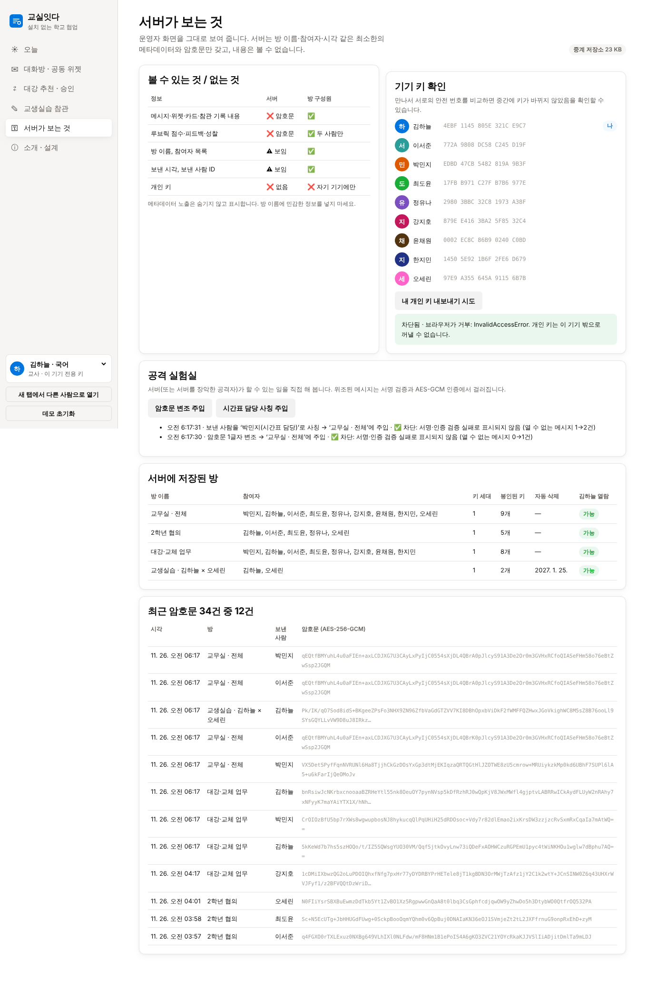
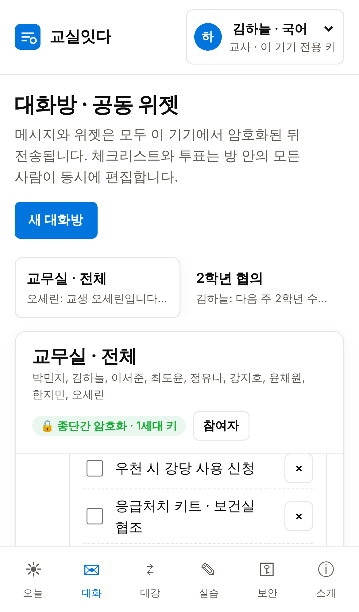

# 교실잇다 · 설치 없는 학교 협업 PWA

> 사범대 웹콘텐츠 개발 대회 출품용 1차 MVP. 브라우저만 있으면 PC·태블릿·스마트폰에서 바로 열립니다.

교실잇다는 학교 현장의 세 가지 문제를 웹 표준만으로 풉니다.

| 현장 문제 | 교실잇다의 답 |
|---|---|
| 대강 배정이 담당자 감에 의존하고, 대강 교사는 수업 정보 없이 교실에 들어간다 | **설명 가능한 대강 추천** + **수업 인수인계 카드** + 동의→승인→반영 3단계 |
| 교육실습의 참관·피드백이 종이와 구두로 흩어진다 | **교생실습 참관·피드백 워크스페이스** (시각 태그 메모, 블라인드 루브릭, 차이 기반 협의 주제, 인쇄 보고서) |
| 설치형 메신저는 Windows PC와 교내망에 묶이고 교생·외부인은 들어오기 어렵다 | **무설치 PWA** + **Web Crypto 종단간 암호화** + 대화방 안 **실시간 공동 위젯** |

| 대강 추천 · 근거 · 개인정보 점검 | 교생 루브릭 블라인드 비교 |
|---|---|
|  |  |
| **서버가 보는 것 · 공격 실험실** | **모바일 (iPhone 13)** |
|  |  |

## 빠른 실행

```bash
npm install
npm run dev        # 개발 서버
npm test           # 단위 테스트 18개 (암호화, 추천, 승인, CRDT, 루브릭)
npm run build      # dist/ 정적 파일 → 어떤 정적 호스팅에도 배포 가능
npm run preview
```

### 2분 시연 시나리오

1. 첫 화면 왼쪽 아래 **“새 탭에서 다른 사람으로 열기”**로 두 탭을 나란히 둡니다(주소 뒤 `?as=t3`처럼 사람을 지정할 수도 있습니다).
2. **대화방** · 한 탭에서 체크리스트 항목을 체크하면 다른 탭에 즉시 반영됩니다.
3. **대강 추천** · 김하늘(`t1`)로 요일과 교시를 고르면 후보별 점수와 근거가 나옵니다. 인수인계 카드에 “민수 학생은 010-…”을 쓰면 개인정보 경고가 뜹니다.
4. 대강 교사 탭에서 **맡겠습니다** → 박민지(`t3`, 시간표 담당) 탭에서 **승인** → 양쪽에서 3단계 완료가 보입니다.
5. **교생실습** · 오세린(`s1`, 교생)으로 루브릭 비교와 협의 주제를 확인하고 **보고서 → 인쇄**를 누릅니다.
6. **서버가 보는 것** · 서버에 저장된 암호문을 보고, “암호문 변조 / 시간표 담당 사칭 주입”이 차단되는 것을 확인합니다. “개인 키 내보내기 시도”는 브라우저가 거부합니다.
7. 오세린으로 **대강 추천**을 열면 업무방 키가 없어 내용을 볼 수 없습니다.

## 설계

```
[브라우저 · PWA] ──서명된 암호문──> [중계 서버] <──서명된 암호문── [브라우저 · PWA]
 Web Crypto                          암호문 · 봉인된 방 키 · 공개 키만 저장
 ECDH P-256 · AES-256-GCM · ECDSA    (시연판: localStorage + BroadcastChannel)
 개인 키는 내보낼 수 없는 CryptoKey(IndexedDB)
```

- **암호화** (`src/core/crypto.ts`) · 방마다 AES-256-GCM 방 키를 만들고, 참여자마다 ECDH(P-256) → HKDF-SHA-256으로 유도한 키로 봉인합니다. 메시지는 방·키 세대·보낸 사람·메시지 ID를 AAD로 묶고, 보낸 사람의 ECDSA 서명을 붙입니다. 참여자가 바뀌면 방 키를 새 세대로 교체합니다.
- **이벤트 소싱** (`src/core/engine.ts`) · 대화, 위젯 조작, 대강 요청과 승인, 참관 메모와 평가가 모두 같은 “서명된 암호문 이벤트”입니다. 화면은 이 로그를 복호화한 뒤 순수 함수로 접어서(reduce) 만듭니다.
- **대강 추천** (`src/core/cover.ts`) · 공강 교사를 형평성·당일 부담·연속 수업 피로·교과 연계·학급 친숙도로 점수화합니다. 모든 점수에 이유 문장이 붙고, 가중치는 학교 정책으로 조정합니다. 결정은 사람이 합니다.
- **승인 상태 기계** (`src/core/approval.ts`) · 권한 없는 전이는 무시되지 않고 “거부된 시도”로 처리 기록에 남습니다. 동의 생략 승인은 사유가 있어야만 됩니다. 역할은 메시지 안의 주장이 아니라 서명한 사람으로 판단합니다.
- **공동 위젯** (`src/core/widgets.ts`) · 필드별 LWW 레지스터 CRDT라 도착 순서와 무관하게 수렴합니다(테스트에서 120가지 순서 전부 확인). 전송을 WebRTC P2P로 바꿔도 그대로 동작합니다.
- **교생실습** (`src/core/practicum.ts`) · 자체 작성한 5영역 4수준 루브릭입니다. 자기평가와 지도교사 평가의 차이가 가장 큰 영역을 협의 주제로 제안합니다. 실습 공간은 60일 뒤 서버에서 자동 삭제됩니다.
- **디자인** · 이 저장소의 [`design-md/notion/DESIGN.md`](../design-md/notion/DESIGN.md) 토큰(따뜻한 중립색, 얇은 테두리, 단일 파란 강조색)을 따릅니다. 자세한 규칙은 [`DESIGN.md`](./DESIGN.md)에 있습니다.

## 측정

| 항목 | 값 |
|---|---|
| 첫 로드 (HTML+JS+CSS+매니페스트, gzip) | 약 92 KB (`npm run build` 로그와 소개 화면에 자동 기록) |
| 비교: 분석한 설치형 교내 메신저 | 교직원 앱 설치 파일 222.6 MiB, 서버 앱 227.3 MiB, 설치 후 538 MB |
| 런타임 의존성 | React, React DOM (그 외 없음) |
| 브라우저 E2E (Playwright, 두 탭 동시) | 동의→승인 실시간 반영, 위젯·메시지 동기화, 교생의 업무방 접근 차단, 변조·사칭 차단, 개인 키 내보내기 거부, 모바일(iPhone 13) 가로 넘침 0px, 콘솔 오류 0건 |

## 정직한 한계

- 시연판은 한 브라우저 안에서 모든 사람의 기기 키를 만듭니다. 실제 서비스에서는 각자 자기 기기에서 키를 만들고 공개 키만 등록합니다.
- 같은 키 세대 안에서는 순방향 비밀성이 없습니다. 큰 그룹에는 MLS(RFC 9420)가 다음 단계입니다.
- 방 이름·참여자·보낸 시각은 서버가 봅니다(“서버가 보는 것” 화면에 그대로 표시).
- 루브릭 블라인드는 화면 규칙입니다. 두 사람은 같은 방 키를 갖습니다.
- 개인정보 점검은 정규식 기반 경고이며 완전한 탐지가 아닙니다.
- 시간표와 사람은 모두 가상 데이터입니다. NEIS 연동과 실제 중계 서버는 범위 밖입니다.

## 로드맵

1. HTTPS 중계 서버(암호문 저장소)와 Web Push 알림
2. 같은 학교 기기 사이 WebRTC DataChannel 직접 동기화
3. 기기 추가·복구(복구 키를 사용자가 보관)와 안전 번호 QR 비교
4. 인수인계 카드 초안을 수업 자료에서 자동 생성하는 보조 기능(결정은 교사)
