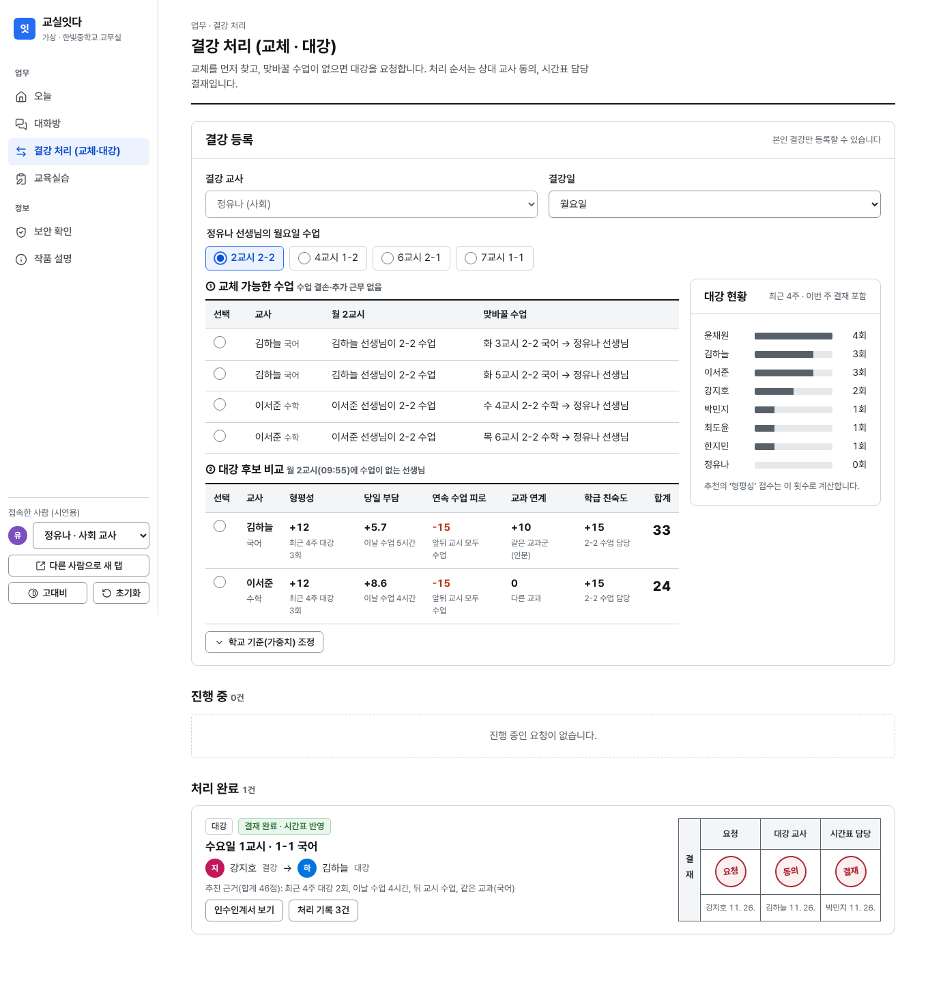
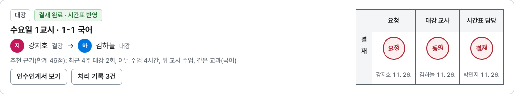
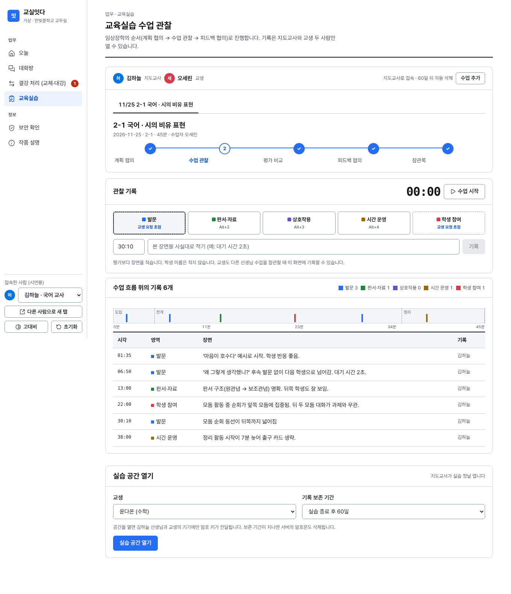
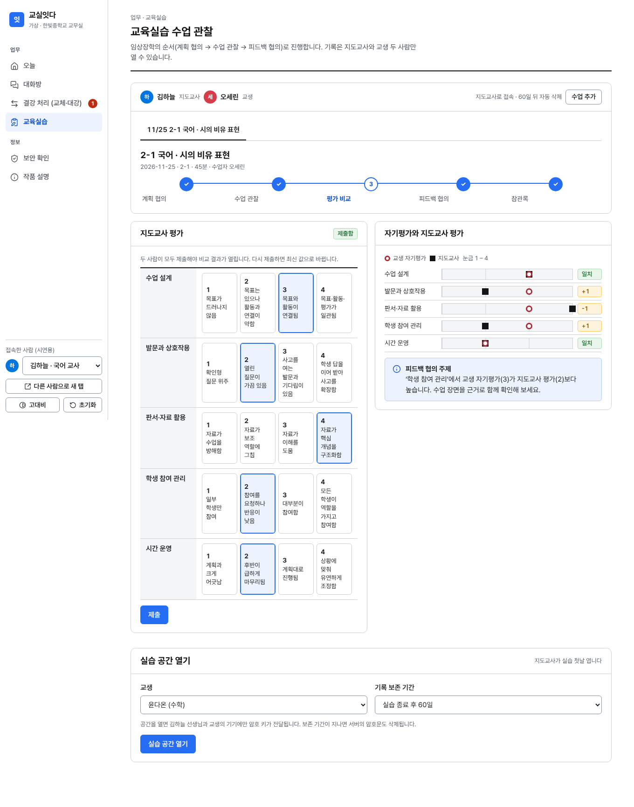
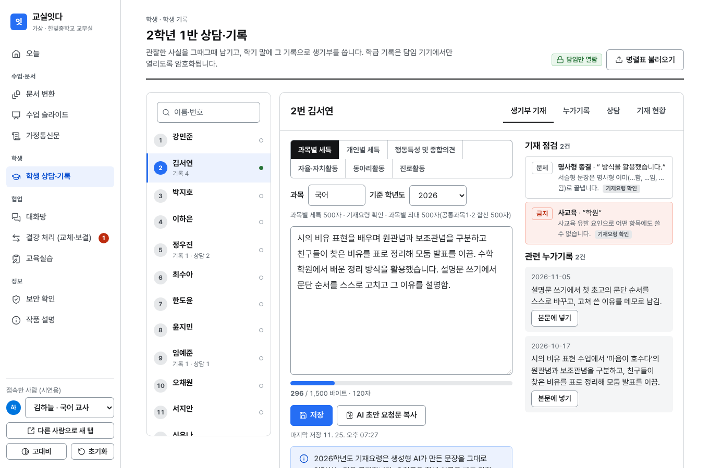
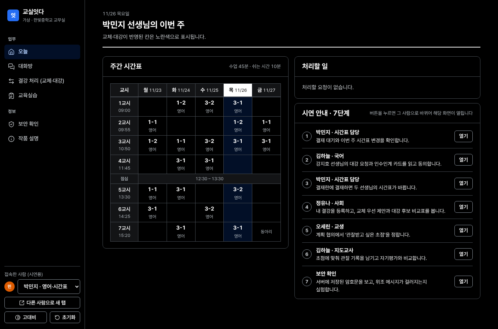

# 교실잇다 · 설치 없는 학교 협업 PWA

사범대 웹콘텐츠 개발 대회 출품작(3차 개선판)입니다. 결강 처리·교육실습 같은 협업 업무에 더해, 교사가 매일 만지는 문서·수업 자료·통신문·학생 기록을 한곳에서 다룹니다. 브라우저만 있으면 PC·태블릿·스마트폰에서 열립니다.

| 현장 업무 | 교실잇다가 하는 일 |
|---|---|
| **결강 처리** | 같은 학급 안에서 맞바꿀 수 있는 수업(교체)을 먼저 찾습니다. 없으면 공강 교사를 형평성·당일 부담·연속 수업·교과·학급 기준으로 비교한 보결 후보표를 보여 줍니다. 수업 인수인계서가 함께 가고, 상대 교사 동의 → 시간표 담당 결재가 **결재란**에 도장으로 남습니다. |
| **교육실습** | 임상장학 순서(계획 협의 → 수업 관찰 → 피드백 협의)로 진행합니다. 교생이 정한 관찰 초점을 지도교사 화면이 강조하고, 자기평가와 지도교사 평가를 모두 받은 뒤 차이가 큰 영역을 협의 주제로 제안합니다. 마지막에 **참관록** 서식으로 정리합니다. |
| **대화방** | 종단간 암호화 메시지와, 방 안의 모두가 함께 편집하는 체크리스트·투표. |
| **문서 변환** | HWP·HWPX·DOCX·XLSX·PPTX·PDF·CSV를 AI가 읽기 좋은 Markdown으로 바꾸고, 고친 내용을 HWPX·DOCX·XLSX·MD로 다시 저장합니다. 개인정보 가리기, AI용 복사, 다른 도구로 넘기기를 지원합니다. 파일은 브라우저 밖으로 나가지 않습니다. |
| **수업 슬라이드** | 지도안(파일 또는 붙여 넣기)에서 학습 목표·수업 흐름·발문·활동·모둠 역할·확인 문제·정리 슬라이드를 만듭니다. 템플릿 5종(파스텔 노트, 형광펜, 칠판, 블루 미니멀, 라벤더), 제목 글꼴은 페이퍼로지. **HTML 발표 파일**(글꼴 포함, 활동 타이머·발표자 메모)과 편집용 PPTX로 저장합니다. |
| **가정통신문** | 내용만 넣으면 발행 정보·안내 표·학교장 직인·회신서까지 갖춘 A4 통신문이 됩니다. 쉬운 말 점검과 공공언어 검수를 함께 합니다. 학교에서 쓰는 HWPX 양식을 올리면 그 양식의 빈칸을 찾아 서식을 유지한 채 채워 줍니다. |
| **학생 상담·기록** | 누가기록, 상담 기록(대상·방식·영역·후속 조치), 생기부 기재 도우미. 세특·행특 등 항목별 NEIS 바이트 계산, 금지·주의 표현 점검, 관련 누가기록 끌어오기, 이름을 뺀 AI 초안 요청문, 학급 기재 현황과 NEIS 입력용 엑셀. 학급 기록은 담임 기기에서만 열립니다. |

| 결강 처리: 교체 우선 제안과 보결 후보 비교표 | 결재란 |
|---|---|
|  |  |
| **교육실습: 관찰 초점과 관찰 기록** | **자기평가와 지도교사 평가 비교** |
|  |  |
| **문서 변환** | **수업 슬라이드** |
|  |  |
| **가정통신문** | **학생 상담·기록** |
|  |  |
| **고대비 모드 (KRDS)** | **모바일** |
|  |  |

## 용어

| 용어 | 뜻 |
|---|---|
| 결강 | 출장·연가 등으로 교사가 자기 수업을 하지 못하는 것 |
| 교체 | 결강 수업과 다른 교사의 수업을 서로 맞바꾸는 것. 학생은 수업을 잃지 않고, 누구도 시수가 늘지 않습니다. |
| 보결 | 다른 교사가 결강 수업을 대신 맡는 것(보결수업) |

이전 판의 ‘대강’은 공문과 수당 명칭에 맞춰 ‘보결’로 바꿨습니다. ‘보강’은 빠진 수업을 나중에 채우는 보충 수업과 뜻이 겹쳐 쓰지 않습니다.

## 3차 개선에서 바뀐 것

- **문서 엔진:** [kordoc](https://github.com/chrisryugj/kordoc) 4.24.66(MIT)을 브라우저에서 돌도록 묶었습니다(Node 내장 모듈 대체, Buffer 폴리필, 지연 로딩). DOCX·XLSX 쓰기는 직접 만든 OOXML 작성기를 씁니다. 왕복 변환 테스트가 있습니다.
- **슬라이드:** 같은 배치 엔진(13.333×7.5 in)으로 화면 미리보기, HTML 발표 파일, PPTX(pptxgenjs 4.0.1)를 만듭니다. 미리캔버스·캔바 교육용 템플릿에서 흔한 구성(큰 제목, 둥근 카드, 단계 번호, 진행 표시)을 참고했고, 템플릿 그림이나 레이아웃을 복제하지는 않았습니다. 본문은 26pt 이상이고, 다섯 템플릿 모두 글자 대비 WCAG AA를 맞췄습니다.
- **생기부 규칙:** 기재 금지·주의 규칙마다 근거의 확실성(기재요령 확인 / 원문 대조 필요 / 관례)을 표시합니다. 학년도별 글자 수 한도를 바꿀 수 있습니다. 최종 판단은 학교 기재요령과 교사가 합니다.
- **화면:** 메뉴를 ‘수업·문서 / 학생 / 협업 / 정보’로 묶었고, 모바일은 하단 탭 4개 + 전체 메뉴 시트로 바꿨습니다. ‘오늘’ 화면에 새 도구 바로가기를 넣었습니다.

## 2차 개선에서 바뀐 것

심사위원·개발 전문가·현장 전문가 관점의 비판 검토와 조치는 [`docs/REVIEW.md`](docs/REVIEW.md)에 정리했습니다. 요약하면 다음과 같습니다.

- **디자인:** 대한민국 정부 디자인 시스템(KRDS) 공식 토큰(`krds-uiux` 1.1.0, NIA 배포)으로 전환했습니다. 이모지 아이콘은 Lucide 선 아이콘으로 바꿨고, 결재란·시간표·참관록 같은 학교 서식을 화면 언어로 썼습니다. KRDS 고대비 테마도 넣었습니다. 정부 상징이나 공식 누리집 표시는 쓰지 않습니다.
- **현장:** 교체 우선 제안, 학교 전체 보결 현황표, 임상장학 3단계와 관찰 초점, 교생의 참관 기록, 실습 공간 개설 화면, 7단계 시연 안내를 추가했습니다.
- **개발:**
  - 중계 저장소를 항목별 키로 바꿔 동시 쓰기 유실을 없앴습니다(실험에서 80건 중 38건 유실 → 0건).
  - 엔진 통합 테스트를 추가했습니다.
  - 미래 시각으로 위조된 이벤트를 거부합니다.
  - 접근성 위반을 0건으로 줄였습니다.

## 실행

```bash
npm install
npm run dev        # 개발 서버
npm test           # 단위·통합 테스트 48개
npm run build      # dist/ 정적 파일 + dist/kyosil-itda.html(단일 파일: 협업 기능만, 문서 엔진·글꼴은 dist/ 판에서)
npm run preview
```

### 시연 순서

‘오늘’ 화면의 **시연 안내 · 11단계**를 차례로 누르면 됩니다. 버튼마다 그 단계의 사람으로 바뀌어 해당 화면이 열립니다. 두 탭을 나란히 두고 보려면 주소 뒤에 `?as=t3`처럼 사람을 지정합니다(`t1` 김하늘, `t3` 박민지·시간표 담당, `t5` 정유나, `s1` 오세린·교생, `s2` 윤다온·교생).

## 검증 결과

| 항목 | 결과 |
|---|---|
| 단위·통합 테스트 (Vitest) | 48개 통과. 문서 왕복 변환(DOCX·XLSX·HWPX ↔ Markdown), 지도안 해석과 슬라이드 배치, 통신문 Markdown·쉬운 말 점검, NEIS 바이트와 생기부 점검 규칙 포함. 한국어 조사 선택, 암호화, 교체 제안의 충돌 없음, 추천, 결재 상태 기계, CRDT 수렴, 루브릭 비교, 엔진 경로(비구성원 차단, 키 교체, 위조·변조·미래 시각 거부, 동시 쓰기 30건 보존) |
| 브라우저 E2E (Playwright, 두 탭) | 동의 → 결재 실시간 반영, 교체 요청, 개인정보 경고, 위젯·메시지 동기화, 관찰 초점 표시, 실습 공간 개설, 교생의 업무 공간 접근 차단, 위조 차단, 콘솔 오류 0건 |
| 새 도구 E2E (Playwright) | 예시 DOCX 변환 → HWPX·DOCX·XLSX·MD 저장, 슬라이드로 넘기기 → HTML 발표 파일·PPTX 저장, 통신문 HWPX 저장, 학교 양식(HWPX) 빈칸 채우기, 누가기록 추가, 생기부 점검, NEIS 엑셀, 담임이 아닌 교사의 학급 기록 접근 차단, 콘솔 오류 0건 |
| 접근성 (axe-core 4.10.3, WCAG 2.2 A·AA) | 새 화면 5개 포함, 기본·고대비 모드에서 위반 0건 (1차판: 명도 대비 최대 25건/화면, ARIA 오류 5건) |
| 모바일 (390px) | 오늘·문서 변환·수업 슬라이드·가정통신문·학생 기록·결강 처리·교육실습 화면 가로 넘침 0px |
| 첫 로드 (gzip) | 약 115 KB (HTML·JS·CSS·글꼴 선언, 빌드 로그에 자동 기록). 한글 글꼴 파일은 필요한 글자 범위만 나중에 받습니다. |

## 설계

- **암호화** (`src/core/crypto.ts`): 방마다 AES-256-GCM 키를 만들어 참여자별로 ECDH P-256 + HKDF로 봉인합니다. 메시지는 방·키 세대·보낸 사람·메시지 ID를 AAD로 묶고 ECDSA 서명을 붙입니다. 개인 키는 꺼낼 수 없는 CryptoKey로 보관합니다.
- **중계 저장소** (`src/core/relay.ts`): 암호문 봉투, 방 정보, 공개 키를 항목마다 별도 키로 저장합니다(시연판은 localStorage와 BroadcastChannel). 서버가 보는 정보는 ‘보안 확인’ 화면에 그대로 보입니다.
- **업무 로직:** 모든 기록은 서명된 암호문 이벤트이고, 화면은 순수 함수로 이를 접어서 만듭니다.
  - 결강: `cover.ts`(교체 제안, 보결 추천, 개인정보 점검), `approval.ts`(결재 상태 기계)
  - 교육실습: `practicum.ts`
  - 공동 위젯: `widgets.ts`(CRDT)
- **디자인:** [`DESIGN.md`](DESIGN.md)에 KRDS 토큰 대응표와 컴포넌트 규칙이 있습니다.

## 한계

- 시연판은 한 브라우저 안에서 모든 사람의 기기 키를 만듭니다. 실제 서비스에서는 각자 기기에서 만듭니다.
- 같은 키 세대 안의 순방향 비밀성이 없습니다(대규모 그룹은 MLS 도입 과제).
- 이벤트 시각은 기기가 찍습니다. 미래 시각은 거부하지만, 운영판에서는 중계 서버가 시각을 찍어야 합니다.
- HWP 5.x(바이너리) 파일은 kordoc이 읽지만, 실제 학교 HWP 샘플로는 시험하지 못했습니다. 이미지 글자 인식(OCR)은 넣지 않았습니다.
- 생기부 점검은 보조 도구입니다. 학년도 기재요령 원문과 대조하지 않은 규칙은 화면에 ‘원문 대조 필요’로 표시합니다.
- PPTX는 페이퍼로지가 설치되지 않은 PC에서 다른 글꼴로 보입니다. 발표에는 HTML 발표 파일을 권합니다.
- 단일 HTML 파일판에는 지연 로딩되는 문서 엔진(kordoc, pptxgenjs)이 들어가지 않습니다. 새 도구는 `dist/` 판에서 씁니다.
- KRDS 지정 서체 Pretendard GOV는 npm 배포본이 없어, 같은 계열의 Pretendard(OFL)를 번들했습니다. 기기에 GOV가 설치돼 있으면 그쪽을 먼저 씁니다.
- 시간표와 사람은 가상 데이터입니다(가상의 한빛중학교). 현장 검증은 아직 하지 않았고, 검증 계획은 앱의 ‘작품 설명’에 있습니다.

## 사용한 오픈소스와 글꼴

| 이름 | 버전 | 라이선스 | 쓰임 |
|---|---|---|---|
| kordoc | 4.24.66 | MIT | HWP·HWPX·DOCX·XLSX·PPTX·PDF 읽기, HWPX 쓰기, 양식 채우기, 개인정보 가리기, 공공언어 검수 |
| pptxgenjs | 4.0.1 | MIT | PPTX 저장 |
| JSZip | 3.10.2 | MIT | DOCX·XLSX 작성 |
| markdown-it | 14.3.3 | MIT | Markdown 해석(HTML 입력 끔) |
| Paperlogy(페이퍼로지) | — | SIL OFL 1.1 | 슬라이드 제목·본문. KS X 1001 범위로 줄인 woff2를 번들(`src/assets/fonts/paperlogy/OFL.txt`) |
| Pretendard | 1.3.9 | SIL OFL 1.1 | 화면 글꼴 |
